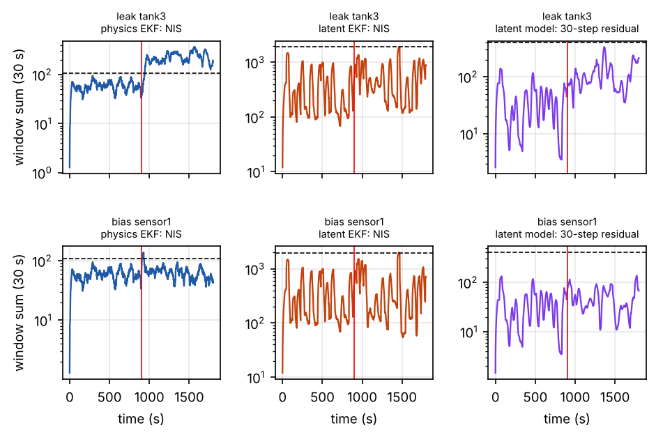
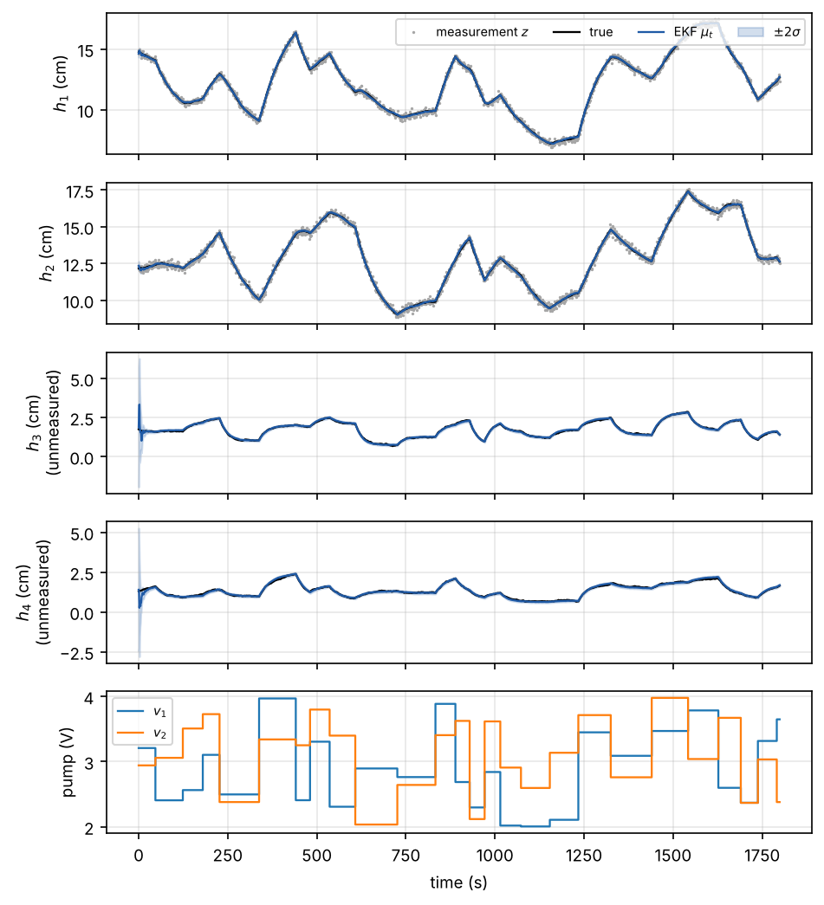
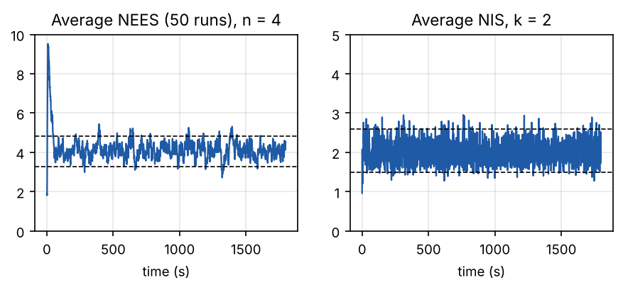
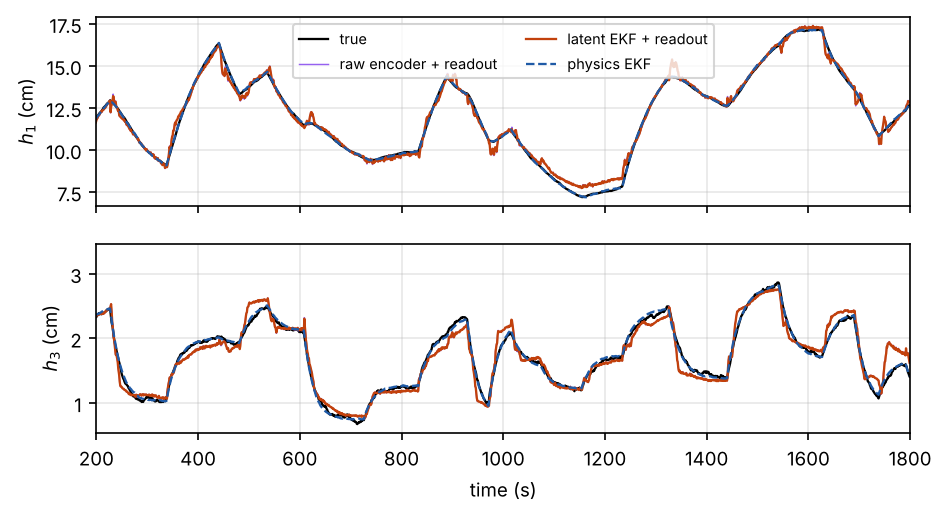
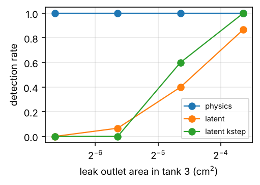

# LatentTrust: Latent-Space EKF with JEPA World Models

**When can a Bayesian filter trust a learned world model?**
An Extended Kalman Filter (EKF) is run two ways on the nonlinear quadruple-tank process (Johansson, 2000): with the physics model, and inside the latent space of a self-supervised, action-conditioned JEPA world model learned from sensor data. Innovation (NIS) consistency tests are then used both to check the filters and to detect faults.

Author: Nilesh Ravishan, University of Moratuwa (EN4594 Autonomous Systems mini project, 2026).



## Key results (50 Monte Carlo runs)

| | Result |
|---|---|
| Physics EKF accuracy | RMSE 0.038 cm on measured levels, 0.034–0.038 cm on the two **unmeasured** tanks |
| Physics EKF consistency | ANEES 4.10, ANIS 2.01; inside their χ² bands about 95% of the time |
| NIS fault monitor | Hidden-tank leak and sensor bias detected in every run, median delays **36 s** and **5 s**; no false alarms observed |
| JEPA world model + latent EKF | Recovers an unmeasured level (h₃ RMSE 0.107 cm) with no physics model, scored with a supervised read-out trained on simulated true levels |
| Honest limitation | Learned latent dynamics are noisier than the measurements (tr R_lat 0.072 > tr Q_lat 0.023), so latent filtering adds only 0.7–1.8% over the raw encoder, and the latent NIS spikes at input steps |

The limitation is the point: a learned model can be accurate on average yet badly calibrated, and a filter that trusts it inherits that miscalibration. Making learned dynamics trustworthy enough for estimation and fault monitoring is the research question this project opens.

## What is implemented (NumPy only)

- `src/lbf/quadtank.py`: quadruple-tank plant (minimum-phase setting) with analytic Jacobians
- `src/lbf/ekf.py`: EKF in *Probabilistic Robotics* notation (process noise R, measurement noise Q), Joseph-form update
- `src/lbf/metrics.py`: RMSE, NEES/NIS and χ² consistency bands, plus NIS change-detection helpers (windowed sum, CUSUM); the reported fault monitor is the 30 s windowed NIS sum
- `src/lbf/autodiff.py`: a small reverse-mode automatic-differentiation engine (gradient-checked)
- `src/lbf/jepa.py`: action-conditioned JEPA world model with an EMA target encoder and VICReg-style anti-collapse
- `src/lbf/latent_ekf.py`: EKF in the learned latent space, with measurement model h(s) = s

## Reproduce

```bash
pip install numpy scipy matplotlib
python tests/test_autodiff.py          # gradient check
python experiments/run_assignment.py   # ~8 min on a CPU; writes results/ (all figures and numbers)
```

The full write-up is in [EKF for State Estimation and Fault Detection in a Quadruple-Tank System](<report/EKF for State Estimation and Fault Detection in a Quadruple-Tank System.pdf>).

## Figures

| | |
|---|---|
|  |  |
| EKF tracking of all four tank levels | NEES/NIS inside χ² bands |
|  |  |
| Latent EKF recovering an unmeasured level | Detection rate vs leak size |
